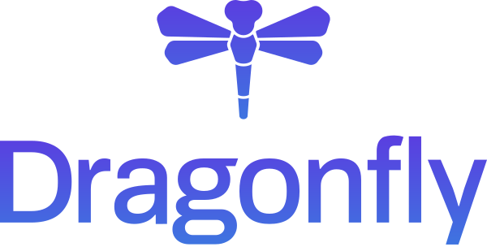
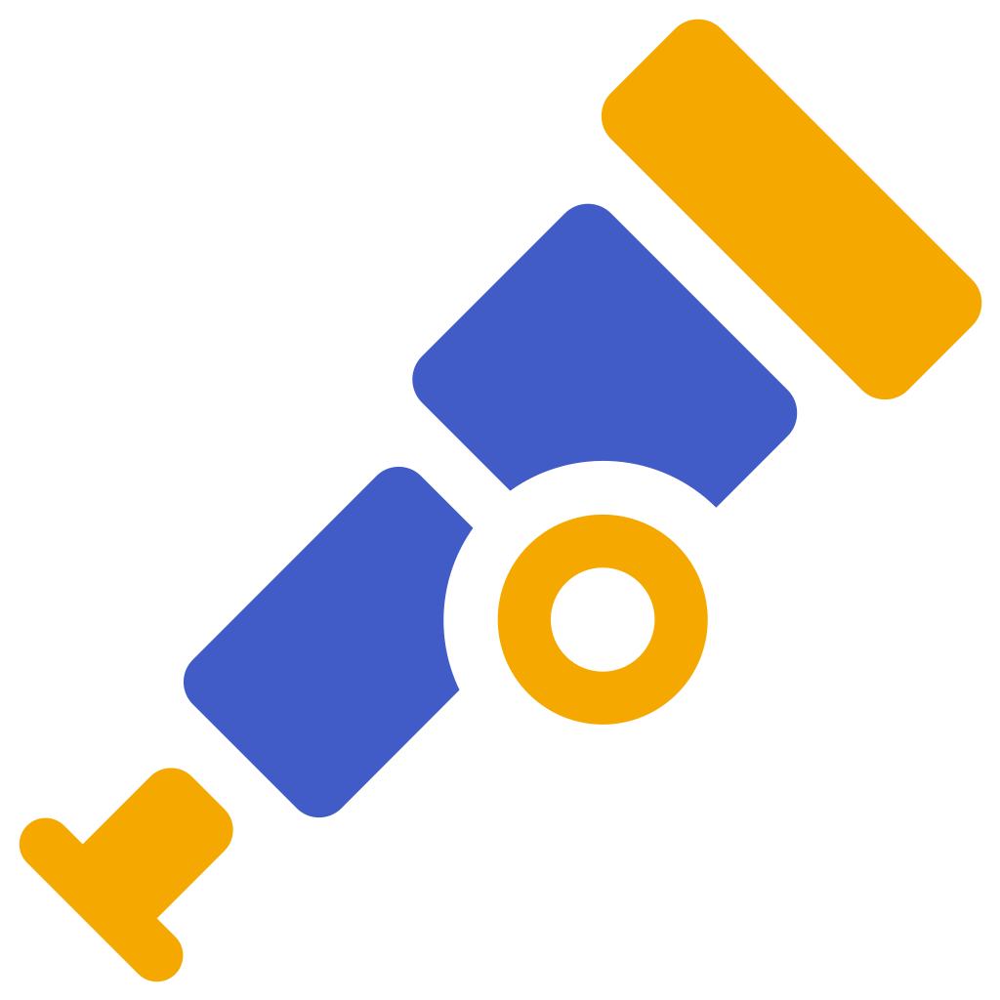

<h1 align="center">Hey, I'm Evgenii 👋</h1>

  <strong>Software Engineer · Architecture · Delivery · Product</strong>

  Turning business needs into useful, maintainable software.

  

  
  
  
  

  Batumi, Georgia · 9+ years in software engineering

---

### 👨‍💻 About me

I'm a software engineer with a systems view of products and how they evolve. My experience spans product development, architecture, technical leadership and infrastructure.

I work from business goals and constraints through to implementation, delivery and continued improvement. I care about the value a solution creates, how it works over time and how easily a team can maintain and develop it.

Alongside commercial work, I volunteer as a **Tech Lead** on nonprofit products, combining hands-on development with shared engineering foundations and team guidance.

### 🎯 My approach

- **Understand the problem:** clarify the goals, constraints and causes before choosing a solution.
- **Think in systems:** address recurring problems at their source and consider how changes affect the wider product and team.
- **Choose tools pragmatically:** weigh usefulness, complexity and maintenance cost against the needs of the task.
- **Own the outcome:** follow decisions through implementation and operation, leaving a clear foundation for future changes.

### ⚡ Selected results

- **P2P marketplace:** built trading workflows for a platform that recorded **127K+ trades and $4M+ turnover in one week**.
- **Written:** reduced redundant backend requests by **~80%** through caching and deduplication, and reduced Docker image size by **30%**.
- **Campaign automation:** cut marketing campaign launch time from **4 days to 2 hours**.

### 🔭 Current focus

**DevOps & platform engineering:** deepening my work on automation, reliable delivery and the foundations that make software easier to operate and evolve.

**Practical AI:** building engineering workflows with Codex, Claude Code, custom plugins and agent instructions. I keep architecture, review and verification explicit throughout the process.

### 🛠️ Tools I work with

**Infrastructure & delivery**

  
  
  
  <picture>
    <source media="(prefers-color-scheme: dark)" srcset="assets/tools/podman-dark.svg" />
    
  </picture>
  
  
  
  
  
  
  
  
  
  <picture>
    <source media="(prefers-color-scheme: dark)" srcset="assets/tools/mise-dark.svg" />
    
  </picture>

**Languages & applications**

  
  
  
  
  
  
  
  
  
  
  
  

**Data & APIs**

  
  
  
  
  
  
  
  

**Quality & observability**

  
  
  

OpenAPI · WebSockets · gRPC

### 🚀 Selected projects

| Project | What it does |
| --- | --- |
| [Julia Shell](https://github.com/kubefox-bot/julia-shell) | A modular workspace with AI chat, an Astro/React UI and a cross-platform Rust agent connected over gRPC. |
| [FCOS Homelab](https://github.com/kubefox-bot/FCOS) | Reproducible infrastructure with declarative Fedora CoreOS configuration, rootless Podman services and recovery documentation. |
| [RCON Web](https://github.com/kubefox-bot/rcon-web) | CS2 server administration with Vue 3, Rust/Axum and Docker Compose. |

I'm also building a **private social app** with SvelteKit and NestJS: real-time chat, an offline outbox, email OTP and video stories.

---

Happy to talk about product engineering, platforms and practical AI. [Say hello →](https://t.me/kubefox47)
